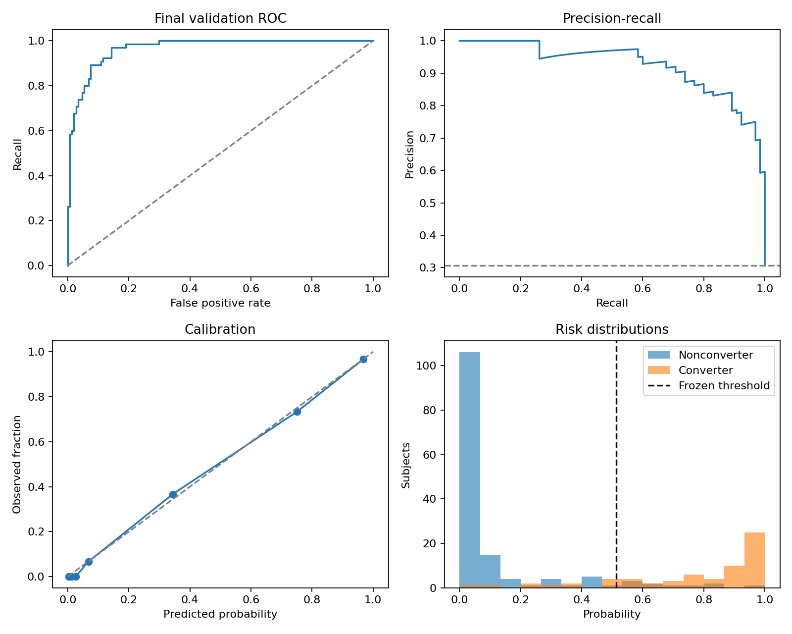

# ADNI five-year dementia prediction

Research pipeline predicting any dementia within five calendar years from a
non-demented participant's original baseline tabular measurements.

The primary selection metric is F1. Accuracy, precision, recall, calibration,
and uncertainty are reported on a frozen subject-level validation partition.

## Data policy

This repository contains code, configuration, synthetic tests, and aggregate
results only. Obtain ADNI data through authorized access. Raw data, prepared
tables, subject IDs, individual predictions, and trained model binaries stay local.
Original source tables and A/B handoffs are never overwritten.

## Completed result

Final validation contains **212 previously unseen subjects**, including 65
converters. The selected model is regularized logistic regression (`C=0.01`,
balanced class weights), with the core panel, scaled KNN imputation, sigmoid
calibration, and a calibration-selected threshold of **0.513078**.

| Metric | Final validation | 95% bootstrap interval |
|---|---:|---:|
| Accuracy | 89.62% | 85.38–93.87% |
| Precision | 83.08% | 75.00–91.67% |
| Recall | 83.08% | 73.85–90.77% |
| F1 | 83.08% | 76.03–89.60% |
| Specificity | 92.52% | 87.76–96.60% |
| ROC AUC | 0.9667 | 0.9447–0.9847 |

Confusion matrix: **136 true negatives, 11 false positives, 11 false negatives,
54 true positives**. The majority-class benchmark achieves 69.34% accuracy
and zero recall. No model or threshold changes were made after final validation.

These results concern **any dementia within five years in ADNI**. The validation
CN/SMC subgroup contains no converters, so it cannot establish sensitivity for
that subgroup. See [methods and limitations](METHODS.md),
[machine-readable results](results/validation_results.json), and
[development comparisons](results/development_comparison.json).



## Reproduce from an authorized local data copy

Install [uv](https://docs.astral.sh/uv/) and Python 3.12. From this repository:

```powershell
uv sync --locked
uv run --locked pytest -q
uv run --locked python -m btp prepare
uv run --locked python -m btp train
uv run --locked python -m btp evaluate
uv run --locked python -m btp predict --input examples/baseline.json
uv run --locked python -m btp reproduce
```

`config.json` defaults to source tables in `../data` and generated artifacts in
ignored `local/`. Paths are resolved relative to the configuration file. Override
with `python -m btp --config path/to/config.json COMMAND`. Training is CPU-only;
the recorded 109 comparisons took about 3.3 minutes of fitting on this machine.
Preparation and the independent reproduction also take time; allow several minutes.

Required local inputs:

| File relative to `data_dir` | Purpose |
|---|---|
| `person_A_features.csv` | 29 supplied baseline predictors |
| `person_B_features.csv` | 31 supplied predictors, with dated corrections |
| `shared_subject_list.csv` | RID and original baseline date |
| `outcome_labels.csv` | Audit comparison only; never used as training labels |
| `tadpole_challenge_201911210/tadpole_challenge/ADNIMERGE.csv` | Baseline eligibility, dates, diagnosis, and phase |
| `DXSUM_05Sep2026.csv` | Rebuilt outcome trajectories |
| `NEUROBAT_06Sep2026.csv` | Date-safe neuropsychology corrections |
| `MEDHIST_06Sep2026.csv` | Pre-baseline condition flags and unavailable-history correction |

`prepare` never overwrites these inputs. It writes `master_baseline.csv`,
corrected labels and B features, reconciliation, provenance, input hashes, and
the feature registry to `local/`.

`train --baseline-only` runs the initial benchmarks. Full `train` adds the bounded
search, preprocessing ablations, selection, calibration, and local `model.joblib`.
Completed comparisons are checkpointed to permit resuming the same configuration.

`evaluate` verifies the frozen model/data/split hashes before opening final
validation. It records that opening and blocks subsequent preparation or training
in that experiment directory. Repeated evaluation returns the cached results.
Use a different `local_dir` for later exploratory experiments; never describe reuse
of the original validation subjects as a fresh validation.

`reproduce` rebuilds preparation and the selected fit in `local/reproduction/`,
then checks identical master data, splits, thresholds, and predictions. It does
not repeat model selection or alter the original artifact.

## Local prediction

The supplied example is synthetic. Inputs use original source-column names and
units, support missing optional measurements, and require a non-demented
`baseline_diagnosis` eligibility declaration. That declaration is never a model
feature. Output includes probability for every case, percentage, threshold,
decision, and model version. A below-threshold result does not mean zero risk.

Only load the locally generated trusted `joblib` artifact. The demo is for research;
there is no UI or clinical deployment.

## Publishing

`python -m btp publish-aggregates` exports an explicit allowlist of aggregate
summaries and plots to `results/`. Review those outputs before committing. Never
force-add ignored data, subject splits, individual predictions, or model files.

## Method

- One baseline row per RID; exclude dementia at or before baseline.
- DXSUM diagnosis 3 is any dementia; incomplete follow-up is unknown, not negative.
- Split subjects 60/20/20 into development, calibration, and final validation.
- Fit preprocessing inside development folds and freeze before final validation.
- No raw imaging, post-baseline predictors, UI, or clinical deployment.

Clinical coding reference: https://adni.loni.usc.edu/quick-start-guide-asset/diagnostic.html
